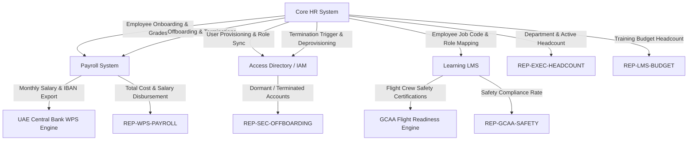

# Emirates Group HR System Dependencies & Report Lineage

This document outlines the upstream and downstream data flows between HR applications and the critical executive and regulatory reports that depend on specific data fields.

---

## 1. System Integration Feeds (Data Flow DAG)

---

## 2. Downstream Reports & Field Dependencies

### REP-EXEC-HEADCOUNT: Executive Headcount & Emaratisation Dashboard
- **Executive Owner**: Chief Human Resources Officer & Group Executive Board
- **Critical Fields**:
  - `core_hr.employment_status`
  - `core_hr.department_code`
  - `core_hr.nationality`
  - `core_hr.work_location`
  - `core_hr.job_grade`
- **Downstream Impact**: Inaccurate headcount sizing, non-compliance with UAE National Emiratisation statutory quotas, board misreporting.

### REP-WPS-PAYROLL: Monthly Wages Protection System (WPS) File
- **Regulatory Authority**: UAE Ministry of Human Resources & Emiratisation (MOHRE) & UAE Central Bank
- **Critical Fields**:
  - `payroll.payroll_id`
  - `payroll.bank_iban`
  - `payroll.monthly_basic_aed`
  - `payroll.pay_status`
  - `core_hr.national_id`
  - `core_hr.employment_status`
- **Downstream Impact**: Bank transaction rejections, financial cash leakage on terminated staff, MOHRE regulatory compliance fines.

### REP-GCAA-SAFETY: GCAA Aviation Safety Compliance & Airworthiness Audit
- **Regulatory Authority**: UAE General Civil Aviation Authority (GCAA) & IATA
- **Critical Fields**:
  - `core_hr.job_title`
  - `core_hr.department_code`
  - `learning.aviation_safety_cert`
  - `learning.compliance_status`
- **Downstream Impact**: Grounding of aircraft, pilot scheduling non-compliance, regulatory audit citations.

### REP-SEC-OFFBOARDING: IT Security & Identity Offboarding Audit
- **Executive Owner**: Group Chief Information Security Officer (CISO)
- **Critical Fields**:
  - `core_hr.termination_date`
  - `core_hr.employment_status`
  - `access_directory.account_status`
  - `access_directory.last_logon_timestamp`
- **Downstream Impact**: Critical data breach, unauthorized access by ex-employees, ISO 27001 audit failure.

### REP-LMS-BUDGET: Group Learning & Development Budget Allocation
- **Executive Owner**: VP Talent & Development
- **Critical Fields**:
  - `learning.assigned_department`
  - `core_hr.job_grade`
  - `payroll.cost_center`
- **Downstream Impact**: Misallocated departmental training charges, inaccurate overhead cross-billing.
