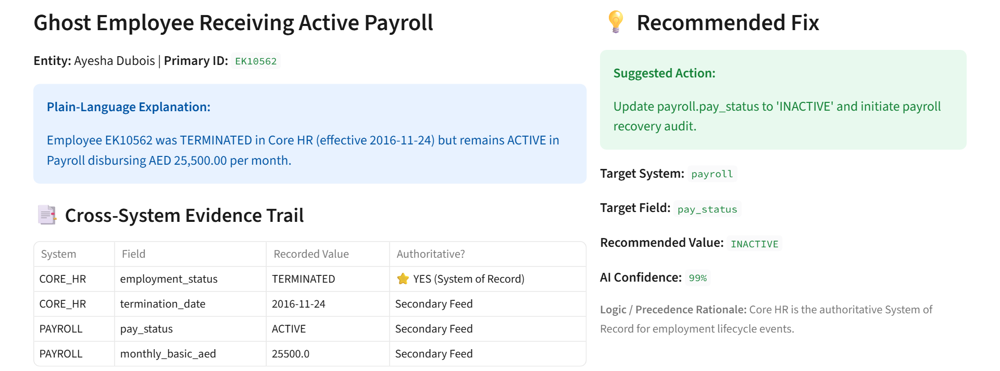
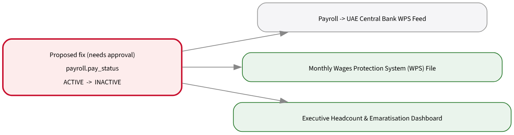

# VeritasHR: One Employee, One Truth
**Solution note: Emirates Group HR Data Quality Challenge (Ignyte)** — [Repo & Code](https://github.com/PegBitStudio/veritashr) • [Demo Video (Google Drive)](https://drive.google.com/file/d/1hzVHcrQZQMo0llZqvo7oXy2aoaLHLOqJ/view?usp=sharing) • [Demo Video (GitHub Mirror)](https://github.com/PegBitStudio/veritashr/blob/main/docs/demo_video.mp4) • [Issue List CSV](https://github.com/PegBitStudio/veritashr/blob/main/submission/issue_list.csv)

## 1. What it does
VeritasHR reads HR extracts in whatever shape they arrive, links each employee across systems, finds and explains inconsistencies, ranks them by business impact, and shows what each fix would touch downstream. **A named person must approve every fix.** Nothing is written back to any HR system.

| Persona | What they get |
|---|---|
| HR data steward | Ranked issue queue; each issue has plain-language explanation, side-by-side evidence, a suggested value *with its basis*, and Approve / Modify / Reject with a reason |
| HR analytics lead | Trust score per report and per field, a "safe to file" flag for regulatory reports, and a question box that shows its interpretation and sources |
| HR systems owner | Downstream impact of each fix (feeds and reports), read from `dependencies.md`; exportable change set of approved fixes only |

## 2. How it works

Ingest any layout→Match people→Detect &amp; explain→Suggest value + basis→Rank &amp; show impact→<b>Human approves</b>→Audit log + change set

1. **Ingest any layout.** Files are found by name hints (`Payroll_Export_Oct.csv` → payroll), and columns are mapped by header aliases *and* by content (a column of `AE…` values is the IBAN; the column whose values overlap Core HR IDs is the employee reference). It handles CSV in any delimiter or encoding, Excel and JSON; dates in 12+ formats; and status words such as `Paid`, `Enabled` or `On Leave`. Every mapping decision is shown to the steward and can be pinned in `schema_mapping.json`. Code lists, code descriptions and report lineage are read from `data_dictionary.md` and `dependencies.md`.
2. **Match people across systems.** Two passes: (a) exact, normalised or numeric ID (`EK10001` = `ek-10001` = `10001`); (b) for records without a usable ID, the name is matched against people not yet claimed. Same-name ties are broken by start date, department and job. Records that match no one become findings (e.g. a payee who is not in HR). Each link records its method, and confidence is lowered for name-based links.
3. **Detect 10 issue families.** These are: ghost pay (left, but still paid); orphan payees and accounts; leavers with live access; department, job, name and status conflicts across systems; invalid codes and formats (department, grade, location, IBAN, Emirates ID, status); impossible or mismatched dates; missing mandatory fields and missing downstream records; exact and fuzzy duplicates, and double payroll records; and expired mandatory training for active staff.
4. **Suggest the most likely correct value, and say why.** Rules apply in order: Core HR is the system of record for employment facts → a clear misspelling maps to the valid code (`EK-FLT-OPS` → `EK-FLIGHT-OPS`) → what other systems hold → what most colleagues in the same job have → the closest code, using the dictionary's descriptions (`DXB-AIR` → `DXB-T3`, "Airport Terminal 3"). The basis is shown in the evidence, and confidence reflects it.
5. **Rank by business impact.** Scores reflect money at risk (annualised salary leakage), security exposure and regulatory reports touched. The impact view walks the feed graph from `dependencies.md` and lists every report that reads the field being changed.
6. **Measure trust.** Trust = the share of records whose fields used by a report have no open issue. A report is "not safe to file" while any critical issue touches it.

## 3. Evidence that it works
We did not have the official pack, so we tested in three ways, all automated in the test suite (34 tests):

| Test | Result |
|---|---|
| Synthetic pack, 20,030 records, 255 planted errors | 255/255 found, 1 extra flag (a real same-name, same-DOB pair) → F1 99.8% |
| Same data **scrambled**: renamed files and columns, `;` delimiter, new date formats and status words, IDs in other formats, 10% of payroll IDs removed | Same result (F1 99.8%), 0 unmatched payroll rows |
| **Blind test**: 80 errors of 10 new types the tool was not built against | 80/80 found, no knock-on false flags |
| **New, unseen system** (a time-attendance file with its own column names) dropped in the folder | Linked and checked automatically: 13/13 planted problems, 0 false alarms |

The full run takes about 3 seconds on a laptop. The only dependencies are the Python standard library for the engine, plus pandas and Streamlit for the dashboard.

## 4. Responsible AI and security
- **Human approval for every change.** Approve, Modify (with a new value) and Reject (with a reason) each require a named reviewer. The tool never writes to source systems. Approved fixes are exported as a change set for the system owner's normal change process.
- **Tamper-evident audit trail.** Each decision is one line in an append-only log. It records the reviewer, UTC time, the current, suggested and final values, a hash of the evidence, and the hash of the previous line. Any edit, deletion or reordering breaks the chain, and the dashboard shows "chain intact" or the exact entry that failed.
- **Explainable by design.** The engine uses deterministic rules and string similarity, not a black-box model. Every suggestion lists its sources, its logic and a confidence score. The question box shows how it read the question and says "I could not map this question" instead of guessing.
- **Data handling.** The tool runs fully offline: no external AI services and no telemetry (disabled in the container). Personal identifiers (IBAN, Emirates ID, date of birth) are masked on screen by default. Source data is mounted read-only, and the container runs as a non-root user. This is designed in line with UAE PDPL (Federal Decree-Law 45/2021). The competition data pack was never uploaded to any external service.
- **Known limits.** Suggestions can be wrong. Low-confidence links and fuzzy duplicates are labelled for human confirmation and are never merged automatically.

## 5. What it looks like

<figure><figcaption>Each issue: plain-language explanation, side-by-side evidence (Core HR marked as system of record), suggested value with confidence and rationale.</figcaption></figure><figure><figcaption>Before approval: the feeds and reports this change touches, read from <code>dependencies.md</code>.</figcaption></figure>

## 6. Running inside Emirates, and reuse
- **Deployment.** A single Docker image (non-root, offline). It runs on an internal VM or a Kubernetes/OpenShift namespace next to read-only replicas or nightly extracts. Sign-in would sit behind the existing SSO reverse proxy, with reviewer identity taken from the SSO header.
- **Adding a new source.** Drop any system's extract into the data folder. It is mapped, linked to Core HR and compared field by field automatically; the steward checks the mapping report and can pin an ambiguous column in a few lines of `schema_mapping.json`. New code lists and report dependencies come from the same markdown files business owners already maintain. No code changes are needed for other GCC government entities using different systems.
- **Pilot (next quarter, 6 weeks).** Weeks 1–2: connect read-only extracts for Core HR, Payroll and Directory, then tune the mapping with system owners. Weeks 3–4: five stewards work the critical queue (ghost pay, leavers with access), with weekly audit-log review by Internal Audit. Weeks 5–6: add Learning and two more systems, publish trust scores for the WPS and GCAA reports, and agree go/no-go criteria (precision on reviewed items, hours saved, AED recovered).
- **Who runs the pilot.** VeritasHR was built by a solo developer, who would lead the pilot. It needs no data-science team, because the engine is rule-based and configured through the data dictionary. Emirates would provide one system owner per connected system (about 2 hours a week) and five HR data stewards.
